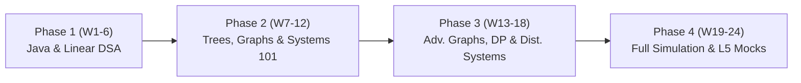

# Senior Software Engineering 24-Week Preparation Roadmap

> **Target Level:** Senior Software Engineer (L5 scope)
> **Transition:** Frontend (React / TypeScript) $\to$ Backend (Java / Distributed Systems)
> **Time Budget:** Build toward 12–15 focused hours per week. The two-hour
> allocation below is a full study-day template, not a daily minimum.
> **Duration:** 24 Weeks (6 Months)

Use the cadence in the coaching profile: begin around 8–12 focused hours per
week and increase only after two stable weeks. The weekend block is part of
that weekly budget, not an automatic extra requirement. Adjust the pace at the
six-week checkpoints and record progress in [PROGRESS.md](../PROGRESS.md).

---

## 1. Senior Software Engineering Interview Scope

For a senior SWE interview, prepare across these areas; the exact loop and
emphasis vary by role and hiring process:

1. **Coding & Problem Solving:** Write clean, modular code; test it with deliberate dry runs and edge cases; explain time and space complexity.
2. **System Design:** A major preparation area for senior roles. Practice driving the conversation, managing ambiguity, evaluating trade-offs (e.g., consistency vs. latency, SQL vs. NoSQL), and designing resilient distributed architectures.
3. **Leadership and Collaboration:** Prepare examples of mentoring, resolving technical disputes, managing ambiguous project scopes, navigating failure, and building cross-functional consensus.
4. **Java / Object-Oriented Maturity:** Writing idiomatic Java (Collections, generics, memory models, exception handling) rather than writing "TypeScript with Java syntax."

---

## 2. Standard Study-Day Template (Up to 2 Hours)

On a planned study day, split up to two hours between algorithmic problem-solving and backend systems. Use fewer sessions when needed; the weekly target and coaching profile take precedence over a daily streak:

```
┌──────────────────────────────────────────────────────────┐
│             STUDY-DAY TEMPLATE (UP TO 120 MIN)            │
├────────────────────────────┬─────────────────────────────┤
│   Track A: Coding & DSA    │  Track B: Systems & Java    │
│         (75 mins)          │          (45 mins)          │
│                            │                             │
│ • 1-2 focused problems     │ • System design concepts    │
│ • Dry-run with manual trace│ • DDIA / Backend reading    │
│ • Clean, modular Java      │ • Behavioral STAR bank      │
└────────────────────────────┴─────────────────────────────┘
```

### Weekend Deep-Work Block (2–3 hours on Saturday or Sunday, included in the weekly target):
* **Phase 1–3:** Implement a data structure from scratch or design a full system end-to-end on an architectural canvas.
* **Phase 4:** 1 full mock interview (DSA or System Design) under strict 45-minute timing.

---

## 3. The 24-Week Roadmap



---

### Phase 1: Java Mastery & Linear Data Structures (Weeks 1–6)
*Goal: Bridge from TypeScript to idiomatic Java; master linear data structures and two-pointer/sliding window patterns.*

* **Week 1: Java for TypeScript Developers & Dev Environment**
  * *DSA Track:* Set up IntelliJ / VS Code, Maven/Gradle, JUnit 5. Master Java Collections: `List`, `ArrayList`, `Map`, `HashMap`, `Set`, `HashSet`, `Deque`, `ArrayDeque`.
  * *Systems Track:* Java Memory Model vs. V8 Engine (Heap, Stack, Garbage Collection, Pass-by-Value references).
* **Week 2: Arrays, Strings & Scratch Implementation**
  * *DSA Track:* Implement `MyArrayList<T>` from scratch (dynamic resizing, amortized $O(1)$). Two pointers (left/right, slow/fast).
  * *Systems Track:* Deep dive into `equals()` and `hashCode()` contracts in Java (why bad hash codes break hash tables).
* **Week 3: Hash Tables & Sets**
  * *DSA Track:* Implement `MyHashMap<K, V>` from scratch (buckets, array of linked lists/trees, handling collisions). Subarray sum equals $K$ pattern.
  * *Systems Track:* REST API design principles, HTTP/1.1 vs HTTP/2 vs gRPC basics.
* **Week 4: Two Pointers & Sliding Window**
  * *DSA Track:* Fixed window, dynamic window, longest substring without repeating characters, minimum window substring.
  * *Systems Track:* Networking fundamentals: TCP 3-way handshake, TLS termination, DNS resolution path.
* **Week 5: Stacks, Monotonic Stacks & Queues**
  * *DSA Track:* Evaluate Reverse Polish Notation, Daily Temperatures, Largest Rectangle in Histogram.
  * *Systems Track:* Relational Databases: Indexes (B-Trees vs LSM-Trees), ACID properties, transaction isolation levels.
* **Week 6: Linked Lists & Recursion Foundations**
  * *DSA Track:* Implement Singly & Doubly Linked List from scratch. Reversing linked lists, cycle detection (Floyd's Tortoise & Hare), merge $k$ sorted lists.
  * *Systems Track:* NoSQL Databases: Key-Value (Redis), Document (MongoDB), Wide-Column (Cassandra). When to pick SQL vs. NoSQL.

---

### Phase 2: Hierarchical Structures & System Design Core (Weeks 7–12)
*Goal: Master tree traversals, search patterns, heaps, and distributed systems building blocks.*

* **Week 7: Binary Trees & Tree Traversals**
  * *DSA Track:* DFS (Pre, In, Post-order), BFS (Level-order). Tree properties: Maximum depth, diameter, Lowest Common Ancestor (LCA).
  * *Systems Track:* Caching strategies: Cache-aside, Write-through, Write-back, Cache invalidation, Eviction policies (LRU/LFU).
* **Week 8: Binary Search Trees (BST) & Binary Search**
  * *DSA Track:* Search in rotated sorted array, find minimum in rotated sorted array, median of two sorted arrays. Validate BST.
  * *Systems Track:* Caching in practice: Redis data structures (Strings, Hashes, Sorted Sets), distributed cache stampede mitigation.
* **Week 9: PriorityQueues & Heaps**
  * *DSA Track:* Min-heap / Max-heap using `PriorityQueue`. Top $K$ frequent elements, Find Median from Data Stream.
  * *Systems Track:* Asynchronous messaging: Message queues vs Event streams (RabbitMQ vs. Apache Kafka). Producer/Consumer, partitions, consumer groups.
* **Week 10: Backtracking & Recursion**
  * *DSA Track:* Permutations, Subsets, Combination Sum, Word Search, N-Queens.
  * *Systems Track:* High Availability: Load balancers (L4 vs L7, round robin, consistent hashing), failover, health checks.
  * *Behavioral Checkpoint:* Write down **Story #1 & #2** in STAR format (Handling high technical ambiguity; Resolving cross-team architectural dispute).
* **Week 11: Introduction to Graphs (BFS & DFS)**
  * *DSA Track:* Adjacency list representation in Java. Number of Islands, Clone Graph, 01 Matrix, Pacific Atlantic Water Flow.
  * *Systems Track:* Sharding and Partitioning: Horizontal vs. Vertical scaling, database replication (Leader-Follower, Multi-Leader), replication lag.
* **Week 12: Topological Sort & Union-Find (Disjoint Set)**
  * *DSA Track:* Course Schedule I & II (Kahn’s algorithm / DFS cycle detection), Number of Connected Components, Redundant Connection.
  * *Systems Track:* **System Design Problem #1:** Design a URL Shortener (TinyURL) end-to-end (Capacity estimations, DB schema, hashing collisions, redirect caching).

---

### Phase 3: Advanced Graph/DP & End-to-End System Design (Weeks 13–18)
*Goal: Tackle advanced algorithmic topics (graphs, intervals, memoization) and senior-level system architectures.*

* **Week 13: Advanced Graphs (Dijkstra, Shortest Path, Minimum Spanning Tree)**
  * *DSA Track:* Network Delay Time, Path with Minimum Effort, Cheapest Flights Within K Stops.
  * *Systems Track:* CAP Theorem & PACELC theorem in real-world systems. Eventual consistency vs Strong consistency.
* **Week 14: Intervals & Greedy Algorithms**
  * *DSA Track:* Merge Intervals, Insert Interval, Non-overlapping Intervals, Meeting Rooms II.
  * *Systems Track:* **System Design Problem #2:** Design a Rate Limiter (Token bucket, Leaky bucket, Sliding window counter in Redis).
  * *Behavioral Checkpoint:* Draft **Story #3 & #4** (Mentoring an underperforming engineer; Navigating a major production outage).
* **Week 15: Dynamic Programming I (1D & Memoization)**
  * *DSA Track:* Practice top-down memoization before optimizing table transitions. Climbing Stairs, Coin Change, Word Break, House Robber.
  * *Systems Track:* **System Design Problem #3:** Design a Distributed Unique ID Generator (Twitter Snowflake).
* **Week 16: Dynamic Programming II (2D & Subsequences)**
  * *DSA Track:* Longest Common Subsequence, Edit Distance, Unique Paths.
  * *Systems Track:* **System Design Problem #4:** Design a Scalable Notification Service (APNs, FCM, email queues, fan-out, prioritization).
* **Week 17: Tries & String Processing**
  * *DSA Track:* Implement Trie (Prefix Tree), Word Search II, Design Add and Search Words Data Structure.
  * *Systems Track:* **System Design Problem #5:** Design Typeahead / Autocomplete System (Trie integration, caching prefix matches, distributed top searches).
* **Week 18: Java Concurrency & Multithreading Fundamentals**
  * *DSA Track:* Thread-safe data structures in Java: `ConcurrentHashMap`, `BlockingQueue`, `AtomicInteger`, `volatile`, `synchronized`.
  * *Systems Track:* **System Design Problem #6:** Design a Distributed Cache (Consistent hashing, replication, cache invalidation protocols).

---

### Phase 4: Full Simulation, L5 Mocks & Polish (Weeks 19–24)
*Goal: Convert knowledge into interview execution under pressure. Practice communication, time management, and mock interviews.*

* **Week 19: Unlabeled Mixed Sets (Mediums & Hards under 25 mins)**
  * *DSA Track:* Stop practicing by category. Do random sets in a plain text editor or shared document without syntax highlighting or autocompletion.
  * *Systems Track:* **System Design Problem #7:** Design a cloud file-storage service (chunking, metadata sync, deduplication, object storage).
* **Week 20: Edge-Case Drilling & Code Review Discipline**
  * *DSA Track:* Focus on self-testing: null inputs, empty lists, single elements, negative numbers, integer overflow (`int` vs `long`).
  * *Systems Track:* **System Design Problem #8:** Design YouTube / Video Streaming Platform (Ingestion, transcoding pipeline, CDN distribution).
  * *Behavioral Checkpoint:* Finalize full **8-story STAR bank**. Practice out loud with 2-minute limit per answer.
* **Week 21: Weekly Mock Interview #1 (DSA + System Design)**
  * *DSA Track:* 45-min timed mock: Clarifying questions (5 min), approach & Big-O (5 min), coding (20 min), dry run & test (10 min), wrap-up (5 min).
  * *Systems Track:* System Design Mock (Requirements, Capacity, High-level, Deep dive, Failure modes).
* **Week 22: Weekly Mock Interview #2 & Graph Focus**
  * *DSA Track:* Re-drill graph and matrix problems.
  * *Systems Track:* **System Design Problem #9:** Design a Distributed Message Queue (Kafka-like architecture).
* **Week 23: Weekly Mock Interview #3 & Leadership Calibration**
  * *DSA Track:* Timed mock focused on modularity and writing clean helper methods.
  * *Systems Track:* Failure mode analysis: cascading failures, circuit breakers, graceful degradation, retry storms.
  * *Behavioral:* Mock behavioral round with emphasis on L5 leadership scope.
* **Week 24: Final Review, Tapering & Mindset**
  * *DSA Track:* Review your "mistake log" and personal pattern cheat-sheets. Light practice only (1 Medium problem/day).
  * *Systems Track:* High-level review of architectural trade-offs.
  * *Mental Prep:* Rest, sleep optimization, and interview day logistics.

---

## 4. Curated Reading List & Resources

### System Design & Backend Foundations (L5 Essential)
1. **Designing Data-Intensive Applications (DDIA)** by Martin Kleppmann (*Chapters 1, 2, 3, 5, 6, 7, 8, 9* are mandatory reading).
2. **System Design Interview – An Insider's Guide (Vols 1 & 2)** by Alex Xu.
3. **Cloud architecture references:** distributed databases, coordination services, and batch processing.

### Java Transition
1. **Effective Java** by Joshua Bloch (Crucial items: Generics, Enums, Equals & HashCode, Concurrency).
2. **Java Collections Framework Official Docs**: Familiarize yourself with `Map.computeIfAbsent()`, `Deque`, `PriorityQueue` comparators.

### Behavioral (Leadership & Collaboration)
* Prepare stories demonstrating:
  * Taking ambiguous requirements and shaping them into clear architecture.
  * Disagreeing with an engineering lead or PM and committing/reaching consensus using data.
  * A time a system you designed failed in production and how you conducted the post-mortem without blame.
  * Driving technical standards across more than one squad or team.
