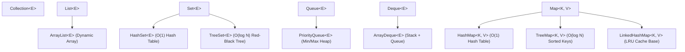

# TypeScript $\to$ Java Cheat Sheet for Senior Engineers (L5)

This guide bridges TypeScript/JavaScript mental models to idiomatic Java for senior-level algorithmic interviews and backend systems.

---

## 1. Type System & Primitives vs Objects

TypeScript's `number` uses JavaScript's IEEE 754 double-precision numeric model. JavaScript engines may optimize how values are represented internally, so avoid thinking of every `number` as a boxed object. In Java, primitive variables hold primitive values and reference variables hold references; where either is stored depends on context (local variable, object field, or array), not a simple primitives-on-stack / objects-on-heap rule. Java `int` is 32-bit, while JavaScript `number` can represent integers exactly only through $2^{53}-1$; use `bigint` / `BigInt` when larger exact integers are needed.

| Concept | TypeScript | Java Primitive | Java Object (Wrapper) | Gotcha in Java |
| :--- | :--- | :--- | :--- | :--- |
| **Integer** | `number` | `int` (32-bit, up to $\approx 2 \times 10^9$) | `Integer` | `Integer` can be `null`; unboxing a null throws `NullPointerException`. |
| **Large Int** | `bigint` / `number` | `long` (64-bit, up to $\approx 9 \times 10^{18}$) | `Long` | Literals need `L` suffix: `long x = 10000000000L;` |
| **Floating Point**| `number` | `double` (64-bit) | `Double` | Use `double` for precision, avoid `float` unless memory constrained. |
| **Boolean** | `boolean` | `boolean` | `Boolean` | `boolean[]` defaults to `false`. |
| **Character** | `string` (len 1) | `char` (16-bit Unicode) | `Character` | Single quotes for char: `'a'`, double for String: `"a"`. |

### The `==` vs `.equals()` Trap (Most Common TS $\to$ Java Bug)
* **In TypeScript:** `===` compares values for primitives, and references for objects.
* **In Java:**
  * `==` on primitives compares **value** (`5 == 5` is true).
  * `==` on references compares whether both refer to the same object.
  * `.equals()` commonly compares logical equality when a class implements it; use identity comparison only when that is what you intend.
```java
// ⚠️ DANGER ZONE: Integer Caching Trap
Integer a = 127;
Integer b = 127;
System.out.println(a == b); // true (Java caches -128 to 127)

Integer x = 128;
Integer y = 128;
System.out.println(x == y); // FALSE! Different heap objects.
System.out.println(x.equals(y)); // TRUE! Always use .equals() for objects.

// For Strings:
String s1 = "sample";
String s2 = new String("sample");
s1 == s2;       // false
s1.equals(s2);  // true
```

---

## 2. Collections Framework Cheat Sheet

Never use raw arrays when you need dynamic resizing. In Java, use interfaces as variable types (`List`, `Map`, `Set`, `Deque`) and concrete implementations for instantiation.



### Quick Mapping Table

| Data Structure | TypeScript Equivalent | Java Interface & Class | Common Methods | Time Complexity |
| :--- | :--- | :--- | :--- | :--- |
| **Dynamic Array** | `const arr: number[] = []` | `List<Integer> list = new ArrayList<>();` | `list.add(val)`<br>`list.get(i)`<br>`list.size()`<br>`list.remove(i)` | Add: Amortized $O(1)$<br>Get: $O(1)$<br>Remove: $O(N)$ |
| **Hash Set** | `const s = new Set<string>()` | `Set<String> set = new HashSet<>();` | `set.add(val)`<br>`set.contains(val)`<br>`set.remove(val)` | Add/Find: $O(1)$ avg |
| **Hash Map** | `const m = new Map<string, number>()` | `Map<String, Integer> map = new HashMap<>();` | `map.put(k, v)`<br>`map.get(k)`<br>`map.getOrDefault(k, 0)`<br>`map.containsKey(k)` | Put/Get: $O(1)$ avg |
| **Stack** | `arr.push(x); arr.pop();` | `Deque<Integer> stack = new ArrayDeque<>();` | `stack.push(x)`<br>`stack.pop()`<br>`stack.peek()` | All operations: $O(1)$ |
| **Queue (FIFO)** | `arr.push(x); arr.shift();` | `Deque<Integer> q = new ArrayDeque<>();` | `q.offer(x)`<br>`q.poll()`<br>`q.peek()` | All operations: $O(1)$ |
| **Heap / PriorityQueue** | *Custom / npm package* | `PriorityQueue<Integer> pq = new PriorityQueue<>();` | `pq.offer(x)`<br>`pq.poll()`<br>`pq.peek()` | Offer/Poll: $O(\log N)$<br>Peek: $O(1)$ |

> [!IMPORTANT]
> **Stack guidance:** For ordinary single-threaded stack operations, prefer `Deque<T> stack = new ArrayDeque<>()`. `java.util.Stack` is a legacy class; choose another implementation when its synchronization or API behavior is specifically required.

---

## 3. High-Frequency Java Idioms in Coding Interviews

### 1. Hash Frequency Counter
In TypeScript:
```typescript
const count = new Map<string, number>();
count.set(key, (count.get(key) ?? 0) + 1);
```
In Java:
```java
Map<String, Integer> count = new HashMap<>();
// Cleanest idiom:
count.put(key, count.getOrDefault(key, 0) + 1);

// Or using modern computeIfAbsent / merge:
count.merge(key, 1, Integer::sum);
```

### 2. PriorityQueue (Min-Heap vs Max-Heap)
Java's `PriorityQueue` is a **Min-Heap by default**.
```java
// Min-Heap (smallest element at top)
PriorityQueue<Integer> minHeap = new PriorityQueue<>();

// Max-Heap (largest element at top)
PriorityQueue<Integer> maxHeap = new PriorityQueue<>((a, b) -> Integer.compare(b, a));

// Custom sorting (e.g., sort intervals by start time):
// int[][] intervals = {{1, 3}, {2, 6}, {8, 10}};
Arrays.sort(intervals, (a, b) -> Integer.compare(a[0], b[0]));
```

### 3. Strings & `StringBuilder`
In JS/TS, string concatenation in a loop is optimized by the V8 engine: `s += ch`.  
In Java, strings are strictly immutable. Doing `s += ch` inside a loop of size $N$ allocates $O(N^2)$ memory and time.
```java
// ❌ SLOW: O(N^2)
String s = "";
for (char c : chars) {
    s += c;
}

// ✅ FAST: O(N)
StringBuilder sb = new StringBuilder();
for (char c : chars) {
    sb.append(c);
}
String s = sb.toString();
```

---

## 4. Interview Notes for Java

1. **Primitive Arrays for Performance:** When dimensions are fixed and bounds are known (e.g., counting lowercase ASCII characters), use `int[] freq = new int[26];` instead of `Map<Character, Integer>`. It avoids autoboxing and shows systems awareness.
2. **Honor the Input Contract:** Handle null and empty inputs when the problem contract allows them; avoid adding behavior the contract does not require:
   ```java
   if (nums == null || nums.length == 0) {
       return new int[]{};
   }
   ```
3. **Writing Clean Helper Methods:** Rather than writing an 80-line loop with nested branches, decompose:
   ```java
   private boolean isValidPlacement(char[][] board, int row, int col) { ... }
   ```
